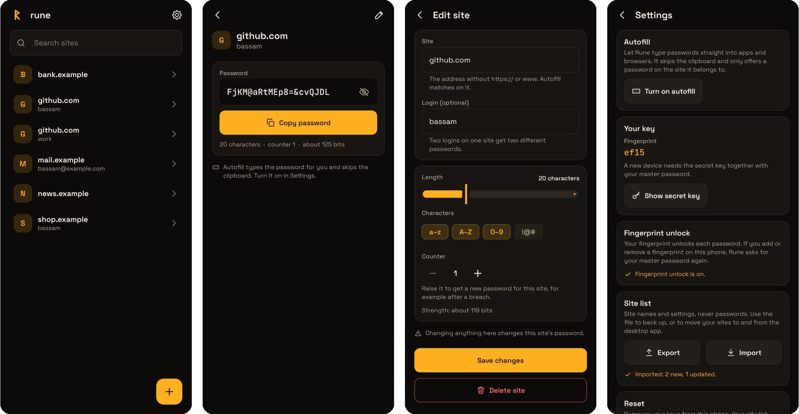
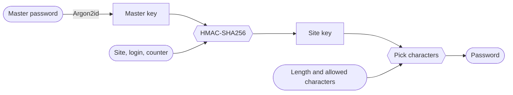

<p align="center">
  
</p>

<h1 align="center">Rune</h1>

<p align="center">
  <b>A deterministic password generator for Android.</b><br />
  One master password becomes a different password for every site. No password is ever stored.
</p>

<p align="center">
  <a href="https://github.com/BassamAlim/rune-android/actions/workflows/ci.yml"></a>
  <a href="LICENSE"></a>
  
</p>



<sub>Rendered from the app's own screens by its screenshot test, not captured on a phone.</sub>

The desktop app is in [`rune-desktop`](https://github.com/BassamAlim/rune-desktop) and produces
the same passwords. The algorithm and file formats are specified in that repo's
[`SPEC.md`](https://github.com/BassamAlim/rune-desktop/blob/main/SPEC.md);
`app/src/test/resources/vectors.json` is a copy of its shared test data.

## How it works



There is no vault to sync, back up or leak: the same master password and site name give the
same password on every device. Only the list of site names and their settings is kept, and it
holds no secrets. The master key stays on the phone, encrypted by a Keystore key that only your
fingerprint opens.

## Features

- **Nothing to steal.** Passwords are worked out from your master password and the site's
  name. They are never stored. Moving in from another manager, a site can keep its old password,
  encrypted under your master password, until you change it to Rune's.
- **Fingerprint for every password.** Your master password is typed once at setup. After that
  each password asks for your fingerprint, with the master password as the fallback.
- **Autofill.** Rune fills login forms in apps and browsers directly, skipping the clipboard.
  In a browser it only offers a password on the site it belongs to.
- **Syncs with your desktop over Wi-Fi.** No server and no account: the two devices find each
  other on your network and exchange the site list, encrypted with a key only your master
  password gives.
- **Approves the desktop.** The desktop app never keeps your master key: when it needs a
  password, this phone shows what it asks for and a six-digit code to compare, and answers
  after your fingerprint.
- **Internet only for logos and names.** Rune asks each site for its own `/favicon.ico` and
  homepage, no third-party service. Passwords and keys never leave the phone except to your
  desktop, after you approve it, though the sites you fetch logos from (and your DNS) can see
  that you have an account there.
- **Per-site settings.** Length, which kinds of character, and a counter you raise to get a
  new password for that site.
- **Same passwords on your desktop.** Set both apps up with the same master password; the
  four-character fingerprint shows they match.
- **Export and import.** The site list is one JSON file, shared with the desktop app.

## Install

There are no store listings or packaged releases yet. Either take the APK attached to the
latest [CI run](https://github.com/BassamAlim/rune-android/actions/workflows/ci.yml) on `main`,
or build it yourself with JDK 21 and the Android SDK:

```bash
git clone https://github.com/BassamAlim/rune-android
cd rune-android
./gradlew :app:installDebug         # build and install on a connected phone
```

Rune needs Android 11 or newer. Without a signing key of your own the build is signed with
your machine's debug key; to use your own, put `KEYSTORE_PATH`, `KEYSTORE_PASSWORD`, `KEY_ALIAS`
and `KEY_PASSWORD` in a `.env` at the repo root.

## Using it

1. Set up with a generated master password (or your own). Learn it; Rune asks for it every two
   weeks so you don't forget.
2. Add a site. Opening it asks for your fingerprint and shows the password.
3. Turn on autofill in Settings to have Rune fill login forms directly.

To use the same passwords on the desktop app, set it up with the same master password. The
site list follows over Wi-Fi, or with Export and Import in Settings.

## Before you rely on it

Rune was written for one person and has had no outside security review. Read the spec's
[known limits](https://github.com/BassamAlim/rune-desktop/blob/main/SPEC.md#8-known-limits)
first; the short version:

- Forgetting the master password loses every password. Nothing can recover it.
- Someone who gets one of your site passwords can guess your master password offline. The
  generated six-word passphrase is out of reach; a weak password of your own is not, and the
  key derivation has no per-user salt to slow an attacker working on many users at once.
- A copied password is readable by other apps while it is on the clipboard; prefer autofill.

## Development

```bash
./gradlew :app:assembleDebug        # build the APK (app/build/outputs/apk/debug/)
./gradlew :app:testDebugUnitTest    # unit tests, and screenshots of every screen
./gradlew :app:lintDebug            # lint
```

The screenshots land in `app/build/screenshots/`. [`AGENTS.md`](AGENTS.md) describes the
architecture and the rules that keep the passwords stable; the one that matters most is that
`core/crypto/Rune.kt` is frozen by `vectors.json`.

## License

Rune is free software under the [GNU General Public License v3.0](LICENSE).

It ships with work by others under their own licenses:

- [Space Grotesk](https://github.com/floriankarsten/space-grotesk) and
  [JetBrains Mono](https://github.com/JetBrains/JetBrainsMono), under the SIL Open Font License
  1.1 ([`licenses/`](licenses)).
- The [EFF large wordlist](https://www.eff.org/dice) (`app/src/main/res/raw/words.txt`), by the
  Electronic Frontier Foundation, under [CC BY 3.0 US](https://creativecommons.org/licenses/by/3.0/us/).
